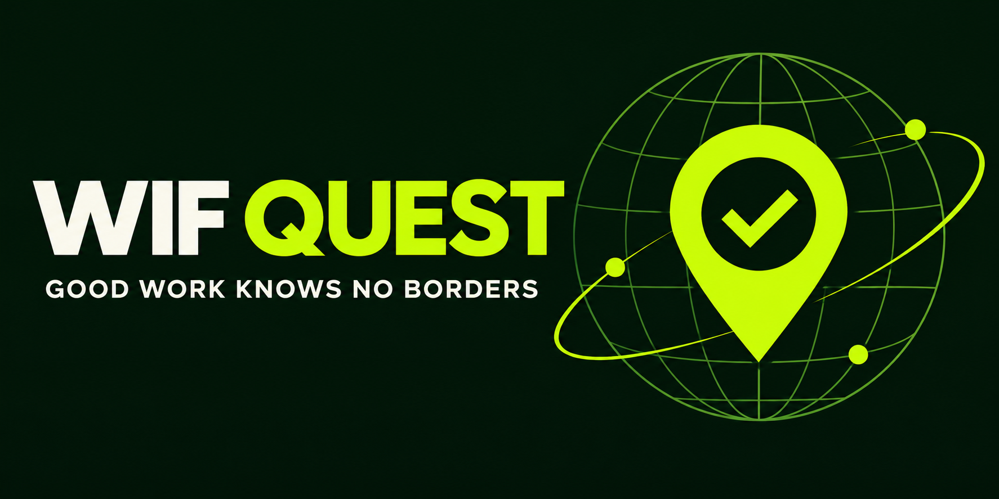

# WIF Quest

WIF Quest is a work-in-progress quest board for creators and contributors. The planned workflow is to fund a quest in $WIF, submit a deliverable, and let the creator approve an onchain payout on Robinhood Chain.

**Status: prototype, not deployed.** The frontend shows an empty state until a real escrow is configured. Optional AI drafting uses the browser's on-device Prompt API where available; it requires a compatible browser, hardware and model download, and has not been validated on all devices. There are no mainnet transaction proofs yet. This prototype has not been audited; do not use it with meaningful funds.

## Prototype preview

[Watch the 24-second prototype preview](video/wif-quest-demo-preview-v2.mp4). It shows the current interface; mainnet escrow and token payments are not yet live.

## Local development

```sh
npm ci
npm test
npm run compile
npm run dev
```

Node 22 or newer is recommended. `npm test` deploys a mock token and the escrow to an in-memory local EVM and checks funding, submission, payout authorization, duplicate payout prevention, and expiry refund. It does not prove mainnet safety or $WIF token compatibility.

## Contract behavior

`QuestEscrow` accepts an ERC-20 token in its constructor. A creator approves the escrow, creates and funds a quest, and a contributor submits a public deliverable. The creator can approve the submission, paying the contributor. After the deadline the creator may refund even if a submission is pending. This means the creator has discretion over acceptance and can ultimately reclaim funds; contributors must trust the creator. There is no dispute resolution. Onchain content is public and permanent. Only one submission is accepted per quest.

The prototype assumes a standard ERC-20 that returns `true` on transfer and is not fee-on-transfer. Verify actual token behavior before deployment. No security audit has been performed. The contract is not a production-ready escrow.

## Configure a deployment

Deploy `contracts/QuestEscrow.sol` with the verified WIF token address as constructor argument. Mainnet configuration should be verified against [Robinhood Chain's documentation](https://docs.robinhood.com/chain/connecting/) and the [WIF project](https://worldisflat.fun/). Set `VITE_ESCROW_ADDRESS` when building. The UI checks that the deployed contract's token matches its configured WIF address before allowing transactions. For GitHub Pages set repository Actions variable `VITE_ESCROW_ADDRESS` and rerun the workflow. Never commit a private key.

## Submission checklist

- [ ] Validate on-device AI drafting on supported hardware and improve compatibility.
- [ ] Review the contract and verify WIF token compatibility.
- [ ] Deploy escrow on Robinhood Chain and configure the frontend.
- [ ] Execute a real funding and payout flow; record explorer links.
- [ ] Record a demo under three minutes showing the actual working flow.
- [ ] Replace planned functionality in the submission with what is actually implemented.
